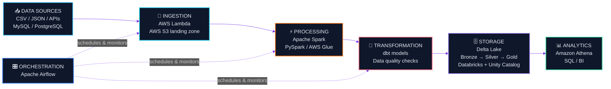

<!-- ============================================================
     Saurabh Anand | Aspiring Data Engineer | GitHub Profile README
     Place this file in a repo named exactly: Saurabhanand12/Saurabhanand12
     ============================================================ -->

<!-- ===================== 1. HEADER ===================== -->
<div align="center">


<a href="https://github.com/Saurabhanand12">
  
</a>

<br/>

<i>"Raw data in. Reliable, well-modeled data out."</i>

<br/><br/>


<br/><br/>

<a href="https://www.linkedin.com/in/saurabh-anand-1810912ba"></a>
<a href="https://leetcode.com/u/sauarbhanand/"></a>


</div>

<br/>

<!-- ===================== 2. ABOUT ME ===================== -->
## 👨‍💻 About Me

<table>
<tr>
<td width="55%" valign="top">

I'm a **Computer Science undergraduate at DSEU, Delhi**, focused on becoming a **Data Engineer**.

I enjoy the part of data work that happens *before* the dashboard: designing pipelines, modeling data, and making sure what lands in the warehouse can be trusted.

- 🔭 Building hands-on skills in **PySpark, SQL and the Lakehouse stack**
- 🏗️ Learning **Medallion Architecture** (Bronze → Silver → Gold) with **Delta Lake**
- ☁️ Exploring **AWS** (S3, Glue, Athena, Lambda) and **Databricks**
- 🔄 Practicing orchestration with **Airflow** and transformation with **dbt**
- 🧮 Sharpening problem-solving through consistent **DSA practice**

</td>
<td width="45%" valign="top">

```python
class DataEngineer:
    name = "Saurabh Anand"
    education = "B.Tech CSE, DSEU"
    location = "Delhi, India"

    focus = [
        "Data Pipelines (ETL / ELT)",
        "Lakehouse & Medallion Architecture",
        "Data Modeling & Data Quality",
    ]

    currently_learning = [
        "PySpark", "dbt", "Airflow",
        "AWS", "Databricks",
    ]

    goal = "Data Engineer role"

    def mindset(self):
        return "Build it. Test it. Make it reliable."
```

</td>
</tr>
</table>

<!-- ===================== 3. TECH STACK ===================== -->
## 🛠️ Technology Stack

<div align="center">

| Category | Technologies |
| :--- | :--- |
| **💻 Programming** |      |
| **⚙️ Data Engineering** |         |
| **☁️ Cloud & Big Data** |       |
| **🔄 Workflow & Transformation** |   |
| **🗄️ Databases** |    |
| **🧰 Tools** |      |

</div>

<div align="center">
  
</div>

<br/>

<!-- ===================== 4. ARCHITECTURE ===================== -->
## 🏗️ Data Engineering Architecture

> The reference architecture I'm learning toward: a cloud **Lakehouse** with **Medallion** layers.
> This is a learning blueprint, not a claim of production deployment.



<div align="center">

| Stage | Tools | Purpose |
| :---: | :---: | :--- |
| 📥 **Sources** | Files, APIs, MySQL, PostgreSQL | Where raw data originates |
| 🔌 **Ingestion** | AWS S3, AWS Lambda | Land raw data safely and cheaply |
| ⚡ **Processing** | Spark, PySpark, AWS Glue | Distributed cleaning and joins |
| 🔧 **Transformation** | dbt, SQL | Tested, version-controlled models |
| 🗄️ **Storage** | Delta Lake, Databricks, Unity Catalog | Governed Bronze / Silver / Gold layers |
| 🎛️ **Orchestration** | Apache Airflow | Scheduling, dependencies, retries |
| 📊 **Analytics** | Amazon Athena, SQL | Query-ready data for insights |

</div>

<br/>

<!-- ===================== 5. PROJECTS ===================== -->
## 🚀 Featured Projects

<table>
<tr>
<td width="50%" valign="top">

### ⚡ PySpark-Basics

A hands-on repository documenting my **PySpark fundamentals** as I build toward distributed data processing.

**Focus areas**
- 🔹 Core PySpark concepts and DataFrame operations
- 🔹 Practice notebooks and code for data processing
- 🔹 Foundation for ETL pipeline work


<br/><br/>

<a href="https://github.com/Saurabhanand12/PySpark-Basics">
  
</a>

<br/><br/>

<a href="https://github.com/Saurabhanand12/PySpark-Basics">
  
</a>

</td>
<td width="50%" valign="top">

### 💻 Lapify AI

A **MERN-based laptop recommendation and price prediction platform**, combining a web application with a machine learning service.

**Highlights**
- 🔹 Laptop **recommendation** experience
- 🔹 ML-powered **price prediction** using XGBoost
- 🔹 React frontend with Node.js / Express backend
- 🔹 FastAPI service serving the Python ML model


<br/><br/>

<!-- Add your repository link here once it is public, for example:
<a href="https://github.com/Saurabhanand12/YOUR-REPO-NAME">
  
</a>
-->

</td>
</tr>
</table>

<br/>

<!-- ===================== 6. DSA & LEETCODE ===================== -->
## 🧮 DSA & LeetCode

<div align="center">

<a href="https://leetcode.com/u/sauarbhanand/">
  
</a>

<br/><br/>


<br/><br/>

<a href="https://leetcode.com/u/sauarbhanand/">
  
</a>

</div>

<br/>

<!-- ===================== 7. GITHUB ANALYTICS ===================== -->
## 📊 GitHub Analytics

<div align="center">


<br/><br/>


<br/>


</div>

<br/>

<!-- ===================== 8. LEARNING JOURNEY ===================== -->
## 🌱 Current Learning Journey

> I'm being upfront: these are skills I'm actively building, not ones I claim to have mastered.

<div align="center">

| Focus Area | What I'm Working On | Status |
| :--- | :--- | :---: |
| 🐍 **Python** | Data processing, scripting, problem solving |  |
| 🗃️ **SQL** | Joins, window functions, query optimization |  |
| ⚡ **PySpark** | DataFrames, transformations, Spark fundamentals |  |
| 🔧 **dbt** | Models, tests, and transformation workflows |  |
| ☁️ **AWS** | S3, Glue, Athena, Lambda |  |
| 🧱 **Databricks** | Delta Lake, Medallion Architecture, Unity Catalog |  |
| 🎛️ **Airflow** | DAGs, scheduling, pipeline orchestration |  |

</div>

<br/>

<!-- ===================== 9. CONNECT ===================== -->
## 🤝 Connect With Me

<div align="center">

<a href="https://github.com/Saurabhanand12"></a>
<a href="https://www.linkedin.com/in/saurabh-anand-1810912ba"></a>
<a href="https://leetcode.com/u/sauarbhanand/"></a>

<br/><br/>

<i>Open to learning opportunities, collaborations and conversations about data engineering.</i>

</div>

<br/>

<!-- ===================== 10. FOOTER ===================== -->
<div align="center">


<br/>


</div>


